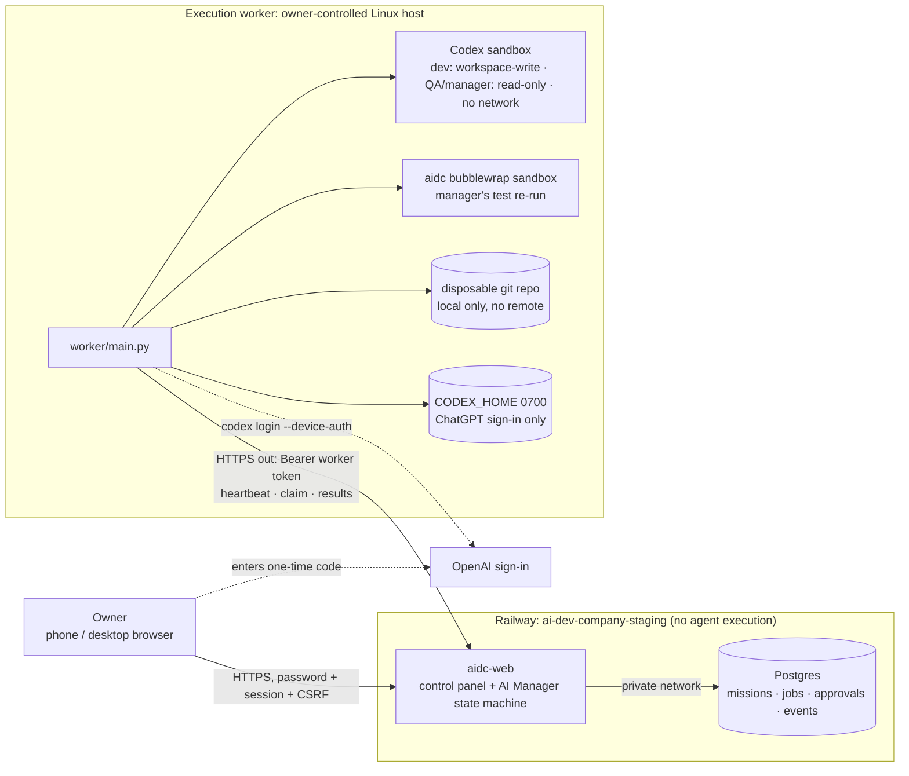

# AI Dev Company — Phase 1.6 Report: Private Railway Deployment & Codex Authentication

Date: 2026-10-30 · Branch `claude/ai-dev-company-phase-1-2y0h5h` · Status: **control panel deployed privately and
verified. Real Codex agent execution is blocked until the owner connects a worker on a machine they control**
(details in §4). Phase 2 was not started. Nothing public-production, no paid API, no Telegram integration.

## 1. What was deployed

| Railway service (project `ai-dev-company-staging`, env `staging`) | Purpose | Public? |
|---|---|---|
| `aidc-web` (Dockerfile `deploy/Dockerfile.web`, commit-pinned) | Private control panel: login, projects, AI Manager status and controls, workers, task submission, approvals, missions, test results, activity log, usage/cost | HTTPS domain, **every data/worker route requires auth** |
| `Postgres` (Railway template, 5 GB volume) | Persistent missions, jobs, approvals, events, sessions, settings | **No public domain, no TCP proxy**: private network only |
| `sandbox-probe` | One-off capability probe (kept per owner instruction; container exits by itself, restart policy NEVER) | No domain |

The project is new and separate. None of the owner's 6 existing Railway projects were read or changed.

## 2. Architecture

**Why the split.** The Railway probe (`runs/phase1_6/evidence/railway-sandbox-probe.txt`, real deploy logs) shows
Railway containers run under a seccomp filter that refuses `unshare(CLONE_NEWUSER)` (EPERM), even though the kernel
allows user namespaces. So `bwrap: Creating new namespace failed: Permission denied`. Codex's Linux sandbox
fails closed (the sandboxed command never ran), and 13 of 15 sandbox tests could only skip. Landlock (ABI 7) is
present, but neither Codex 0.166 nor `aidc.sandbox` has a supported Landlock-only mode. Running agents on Railway
would have required `danger-full-access`, so **agents do not run on Railway**, as instructed.

**Manager loop** (`server/manager.py`): owner submits task → **Codex manager plans** (read-only, JSON schema) →
**owner approves plan** → (loop must be started by the owner) → **developer** (workspace-write, own branch) →
**independent QA** (read-only, separate agent, sees only spec and diff) → **manager review**: re-runs `npm test` in
the OS sandbox, then Codex decides `accept`/`correct` → accept: **owner approves merge** (local disposable repo
only); correct: correction round with the QA findings, **max 5 rounds**, then `needs_owner`. Auto-continue to
the next approved mission exists but is **off** until the owner enables it (unattended execution not enabled).

Stop conditions: owner pause, emergency stop, cancel; subscription usage limit (loop pauses, never switches to API);
isolation violation (emergency stop); job out of retries (mission failed); 5 rounds reached; no approved mission left.

## 3. Verified private staging URL

**https://aidc-web-staging.up.railway.app**, released here only after these checks passed against the live
deployment (`scripts/verify-staging.py`, output in `evidence/staging-privacy-check.txt`): **34/34 passed**.

- HTTPS only (HTTP redirects); CSP, HSTS, `X-Frame-Options: DENY`, `nosniff`, `no-referrer`, `noindex`.
- Anonymous `GET /api/state`, `POST /api/missions|control|approvals|worker-tokens` → 401. All 4 worker routes → 401
  without a token and with a forged token. `/healthz` returns only `{"ok": true}`.
- Wrong password → 403. Initial password signs in, but the panel stays **locked (403) until the owner sets a new
  password**. The cookie is `HttpOnly; Secure; SameSite=Strict`. CSRF is enforced. State contains no secrets.
  Logout ends the session. The loop starts **paused**.
- Mobile (`evidence/mobile-check.txt`, screenshots in `evidence/screenshots/`): the live page renders on iPhone 13
  (390 px), Pixel 7 (412 px) and desktop with no horizontal overflow. The full dashboard was checked on the same
  sizes with a **SIMULATED** worker locally (`dash-*-SIMULATED.png`).
- Restart/persistence (`evidence/railway-restart-persistence.txt`): Railway `restart-service` → new process
  (second "listening" log line at 16:52:36Z), health 200, event ids continue 9 → 10, owner and loop state intact.

The initial password was generated here and only its scrypt hash was set on Railway. It is in a private file
in this session (not in the repo). It works only to set your own password.

## 4. Codex authentication status

| Item | Status |
|---|---|
| Official device-code flow | **Available**: from this container, `codex login --device-auth` (0.166.0) obtained a real one-time code from OpenAI (`evidence/codex-device-auth-attempt.txt`, code redacted). I stopped it deliberately |
| Enabled for the owner's account | **Not yet verifiable**. OpenAI shows this only when the owner enters a code on its page |
| Where credentials will live | Worker host only: `~/.aidc-worker/codex/auth.json` (Codex's supported file store; dir 0700). Never sent to the panel; the panel only relays the verification URL and one-time code (format-validated) |
| ChatGPT-only enforcement | `forced_login_method = "chatgpt"` in the worker's CODEX_HOME and on every `codex exec`; API-key variables stripped; worker refuses agent jobs unless `codex login status` says ChatGPT |
| Survives restarts | By design (file store on the worker's disk), and tested with the simulated flow (worker SIGKILL + restart keeps auth). **Real check pending** (WORKER_SETUP step 6) |
| Real Codex sign-in completed | **No: blocked.** Railway can't sandbox; this cloud container can't reach `auth.openai.com`/`chatgpt.com` (403) and is ephemeral, so it is not a valid worker host. Owner action: `docs/WORKER_SETUP.md` |

## 5. Multi-agent test evidence

**Real Codex agents: not executed yet** (blocked as above). No agent result in this report comes from a real model.

What *is* proven end-to-end with real infrastructure and a **simulated model** (`server/tests/sim_codex.py`;
everything else is real: HTTP server, Postgres, auth, worker process, git worktrees, Codex's real sandbox in the
worker self-test, bubblewrap test re-runs, process kills). `server/tests/test_e2e.py`, 10 tests:

| Requirement | Test | Result |
|---|---|---|
| Owner submits task → manager plans → owner approval gate | `test_03` | plan waits for approval; nothing starts while the loop is paused |
| Delegation dev → independent QA → manager review | `test_03` | jobs `plan, develop, qa, review, develop, qa, review` |
| Manager feedback loop / correction task | `test_03` | review 1 = `correct` → `correction.assigned` → round 2 → accept |
| Tests re-run by manager in sandbox | `test_03` | both reviews: real `npm test` 24/24 inside bubblewrap |
| Never merge without approval | `test_03` | no merge until the owner approves; merge is local-only; repo has no remote |
| Device-code sign-in relay | `test_02` | panel shows the URL and code; agent work refused until auth = chatgpt |
| Cancellation | `test_04` | agent process killed < 20 s after cancel |
| Emergency stop | `test_05` | agent killed; job released (not judged); loop paused; start refused while e-stop is active |
| Worker crash recovery | `test_06` | worker SIGKILL → agent dies too (PDEATHSIG) → restarted worker gets the job back (attempt 2) → mission completes |
| Panel crash/restart | `test_07` | state identical after SIGKILL + restart; worker reconnects |
| Secrets never reach the browser | `test_08` | no API key, worker token, DB URL or password hash in API output |
| Fail-closed without sandbox | `test_09` | worker with a broken bubblewrap: `sandbox_ok=false`, signed-in, still never gets agent work |
| Token revocation | `test_10` | revoked worker token → 401 |

This e2e suite found and fixed 3 real bugs before deployment: failed logins were rolled back, so the rate limit
never triggered; a crash-retried developer job couldn't reuse its branch; and an event-logging argument clash.

## 6. Security test results

| Suite | Result |
|---|---|
| Orchestrator (board, dispatch, integration, sandbox negative tests) | **45/45 OK, 0 skipped** |
| Demo app | **24/24** |
| Control panel + worker e2e | **10/10 OK, 0 skipped** |
| Live staging privacy/auth (`verify-staging.py`) | **34/34** |
| Railway sandbox probe | **Sandbox unavailable** (by design this blocks agent execution there) |

Raw outputs are in `runs/phase1_6/evidence/tests/` and `runs/phase1_6/evidence/`.

Controls in place: owner password scrypt-hashed (N=2^15); must change the initial password; 12 h sessions stored as
SHA-256; CSRF on every write; 5 failures per IP or 20 overall in 15 min lock login; strict CSP with no inline script
and all rendering via `textContent`; worker tokens random (256-bit), shown once, stored hashed, revocable;
redaction of key/JWT/token/DB-URL patterns before anything is stored or returned; QA and manager agents read-only;
developer workspace-write limited to its worktree; network off for agents; per-job timeouts; bounded retries
(1–2 attempts); row-locked claims (no concurrent conflicts, one active mission at a time); git-status canary;
Postgres not exposed; only one HTTP route is unauthenticated, and it returns no data.

**Telegram:** the old bot token in `main`'s history is **still active** (Telegram `getMe` accepted it on
2026-10-30, checked without printing it). Per the owner's instruction, no Telegram work was done and no
Telegram integration exists.

## 7. Monthly cost estimate (observed)

Railway metrics, last hour, staging idle plus test traffic: `aidc-web` RAM ≤ 26 MB (avg 4 MB), CPU avg 0.0005 vCPU;
`Postgres` RAM ≤ 88 MB, CPU avg 0.0006 vCPU, disk 0.15 GB; egress ≈ 0. Railway rates (docs): $10/GB-RAM-month,
$20/vCPU-month, $0.05/GB egress, plus volume storage.

| Item | Estimate / month |
|---|---|
| RAM (≈0.11 GB if both run continuously at their peak) | ≈ $1.10 |
| CPU (≈0.002 vCPU) | ≈ $0.04 |
| Postgres volume (0.15 GB used) | < $0.10 |
| Egress | ≈ $0 |
| **Railway usage total** | **≈ $1–2**, inside the Hobby plan's included usage. The plan's own subscription fee is separate |
| Codex | ChatGPT plan quota only; $0 API. Per-mission agent minutes are shown in the panel |
| Worker host | Owner's existing machine: $0 |

## 8. Remaining limitations

1. **No real Codex run yet.** The owner must set the panel password, connect a worker and complete device sign-in (`docs/WORKER_SETUP.md`).
2. Device-code enablement for the owner's account is unverified until that step.
3. Agents cannot run on Railway (namespace creation blocked). Re-test if Railway adds support, or if Codex offers a supported Landlock-only sandbox.
4. Single owner account with password-only login: no 2FA yet. Railway's identity-aware proxy is an enterprise feature.
5. `HEAD` requests return 501 (cosmetic). Server logs go to stderr, so Railway labels them "error" (cosmetic).
6. The panel polls every 5 s rather than pushing live updates. Usage shows agent time, not token counts (Codex does not expose plan quota remaining).
7. One worker processes one job at a time (deliberate for Phase 1.6). Merge targets only the worker's local disposable repo.
8. The `sandbox-probe` service is kept, idle and exited, until you're happy to delete it.

## 9. Readiness for Phase 2

**Not ready yet; ready once two owner actions succeed:**
1. Set your panel password, connect a worker and complete Codex device sign-in (≈15 min).
2. Run one real mission through plan → develop → QA → review → (correction) → merge approval.

When that real run is recorded, the backend for the Space Command Center UI is in place: missions, jobs, approvals,
events, workers and usage are all available from one authenticated `/api/state`. Unattended execution should stay
off until several real supervised missions complete without an isolation violation.

Phase 1.6 stops here, waiting for supervisor review.
